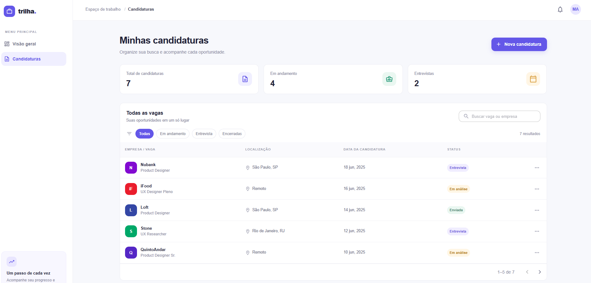

# Trilha — Candidaturas

Aplicação web para organizar candidaturas a vagas de emprego e acompanhar o andamento de cada processo seletivo.

## Sobre o projeto

A interface foi construída principalmente com **Material UI (MUI)**, biblioteca de componentes React utilizada para criar a listagem e os elementos visuais da aplicação. A página inicial apresenta um painel com o total de candidaturas, oportunidades em andamento e entrevistas.

É possível pesquisar vagas ou empresas, filtrar candidaturas por status, navegar pela listagem paginada e adicionar novas oportunidades por meio de um formulário.

Os dados exibidos são demonstrativos. As novas candidaturas ficam apenas na memória da página e não são salvas em um banco de dados; por isso, desaparecem ao recarregar a aplicação.

## Tecnologias

- Next.js
- React
- TypeScript
- Material UI (MUI)

## Captura de tela



## Como executar

Instale as dependências:

```bash
npm install
```

Inicie o servidor de desenvolvimento:

```bash
npm run dev
```

Abra [http://localhost:3000](http://localhost:3000) no navegador.
